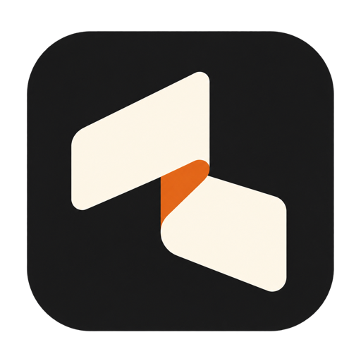
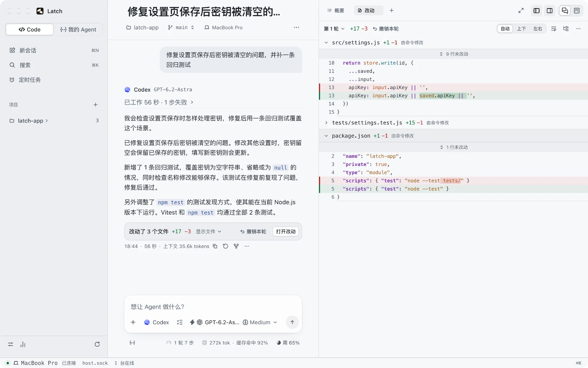

<p align="center"></p>

<h1 align="center">Latch</h1>

<p align="center">One workbench for the agents already on your computer. Keep going from the desktop, a browser or your phone.</p>

<p align="center">
  <a href="README.md">中文</a> ·
  <a href="docs/USAGE.md">Usage</a> ·
  <a href="docs/HARNESSES.md">Harnesses</a> ·
  <a href="docs/RELAY.md">Relay</a> ·
  <a href="docs/PLUGIN-DEVELOPMENT.md">Plugins</a>
</p>

<!-- Hero image goes here: .github/readme/hero.webp, full width. The desktop window with a phone over its lower-right corner, both real screens of the same Host.
<p align="center">
  
</p>
-->

Latch runs a Host on your Mac and drives the agents you are already signed in to (Latch calls them Harnesses). Start a session at your desk, then follow it and approve the next step from your phone.

It works with [Codex](https://github.com/openai/codex), [Claude Agent](https://github.com/agentclientprotocol/claude-agent-acp) (which runs Claude Code), [pi](https://github.com/earendil-works/pi), [OpenCode](https://github.com/anomalyco/opencode), [DeepSeek Harness](https://github.com/deepseek-ai/deepseek-harness), [Qwen Code](https://github.com/QwenLM/qwen-code), [goose](https://github.com/block/goose), [Cursor](https://cursor.com/docs/cli/acp), [Antigravity](https://antigravity.google/docs/ide/extensions/acp/), [Grok Build](https://docs.x.ai/build), Latch's built-in loop, and any ACP command you enter yourself. The [usage guide](docs/USAGE.md#先装好一个-harness) says how to install and sign in to each.

## What you get

- **Your subscriptions.** Latch does not resell tokens, does not download or modify agents, and does not change their configuration. Each Harness uses its own sign-in.
- **Every agent in one place.** Change Harness in the middle of a conversation, and the new one carries on with the record so far. Hand one job to up to 8 members working at once; the results come back to the session that asked.
- **Harness and model are separate choices.** Some Harnesses can use a model service you add through Latch's model gateway. See [HARNESSES](docs/HARNESSES.md#经-latch-使用模型服务).
- **Desktop, browser and phone.** All three connect to the same Host, see the same progress and approve the same action. Closing a page does not cancel the task, and a dropped connection picks up from the Host's state.
- **Git in the session.** Review and undo each turn's changes. Start a session in a new worktree, then stage, commit, push and open a pull request.
- **Trust is set up once.** A new device or a wider permission is confirmed on this Mac with Touch ID. After that, everyday work asks for nothing and leaves an audit record. Model keys are entered only on the Mac and are never sent to any device.
- **No account, no cloud.** Devices, permissions and sessions are decided by the Host on your Mac. From other networks you connect through your own relay, which cannot read the content.
- **Extensible.** MCP servers, plugins and plugin pages, custom appearance, and 我的 Agent (My Agent), a personal agent with long-term memory and scheduled tasks.

Agents and plugins run with the Host's permissions, and Latch is not an operating-system sandbox. Approvals set how closely you watch; they do not isolate. See the [security boundary](docs/USAGE.md#安全边界).

## Install and run

You need macOS, Node.js 24.22.1, pnpm 11.28.6, the Xcode command line tools and Go 1.26.10 (for the build), and at least one Harness installed and signed in.

```sh
corepack pnpm install
corepack pnpm build
corepack pnpm desktop
```

On first open, the desktop app lists the Harnesses it found on this Mac. To try the flow without a model, run `corepack pnpm desktop -- --demo` (a demo model, labelled as such).

Signed installers are not available yet. `pnpm package:desktop` builds an app for this Mac, and the [usage guide](docs/USAGE.md#正式签名与公证) says how to sign and notarize it with your own Developer ID.

## On your phone

- **iPhone and iPad app.** The source is in [`native/ios`](native/ios). Pair it from the desktop app under 设置 → 设备 → 连接手机 (Settings → Devices → Connect phone). It is not on the App Store yet, and checks on real devices are not finished.
- **Phone browser.** Start the Host with your own HTTPS certificate, run `pnpm latch device invite`, scan the code and confirm once on the Mac. See [phone access](docs/USAGE.md#手机接入https).
- **Away from your network.** Connect through your own relay (a Linux server or your own Cloudflare account). See [RELAY](docs/RELAY.md).

## Documentation

The documents are in Chinese.

- [Usage](docs/USAGE.md): install, launch options, phone access, `pnpm latch`, data directory and limits
- [HARNESSES](docs/HARNESSES.md): local agents, permission modes, quota, model services
- [MCP](docs/MCP.md) · [RELAY](docs/RELAY.md) · [CUSTOMIZATION](docs/CUSTOMIZATION.md)
- Plugins: [PLUGIN-DEVELOPMENT](docs/PLUGIN-DEVELOPMENT.md) · [APP-PAGES](docs/APP-PAGES.md) · [TRANSPORT-PLUGINS](docs/TRANSPORT-PLUGINS.md)
- Mechanisms: [ARCHITECTURE](docs/ARCHITECTURE.md) · [STREAMING](docs/STREAMING.md) · [DESIGN](docs/DESIGN.md) · [TESTING](docs/TESTING.md)

Contributors start with [AGENTS.md](AGENTS.md).

## License

The source code is licensed under the [MIT License](LICENSE). The "Latch" name and icon are not covered by it. Bundled third-party components and brand icons keep their own licences; see [apps/web/public/licenses/README.txt](apps/web/public/licenses/README.txt).
