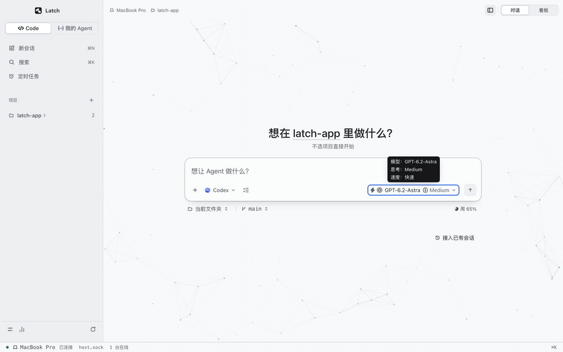

<p align="center"></p>

<h1 align="center">Latch</h1>

<p align="center">Use the Codex, Claude Code and other agents already on your computer, and keep going from the desktop, a browser or your phone.</p>

<p align="center">
  <a href="README.md">中文</a> ·
  <a href="docs/USAGE.md">Usage (Chinese)</a> ·
  <a href="docs/HARNESSES.md">Harnesses</a> ·
  <a href="docs/ARCHITECTURE.md">Architecture</a>
</p>

<p align="center">
  
</p>

Latch runs a Host on your Mac. Sessions, permissions, keys, the devices you connect and the audit record all live there. Each session pairs a Harness (an agent you have installed and signed in to, or Latch's built-in loop) with a model and a project. The desktop app, a browser and your phone connect to the same Host: they see the same progress, approve the same action and cancel the same task. Closing a page does not cancel the task, and a dropped connection picks up from the Host's state.

<p align="center">
  
  <br><sub>A real recording: the Codex on this Mac fixes a bug in a sample project and adds a test. The waiting is sped up about 7×.</sub>
</p>

## What it does

<table>
<tr>
<td width="44%" valign="middle">

### One conversation, another Harness

Switch the conversation to another Harness and it carries on with the record so far, or with just a summary written by the Harness it leaves. Switch back to a Harness you used before and, where it can fork, it resumes its own earlier session instead of reading everything again.

</td>
<td></td>
</tr>
<tr>
<td valign="middle">

### Split the work into a team

Hand pieces of a task to up to 8 members, each on the Harness you choose, all running at once. When the project is a Git repository, each member works in its own worktree. When they finish, the results come back to the session as one message for it to check and sum up.

</td>
<td></td>
</tr>
<tr>
<td valign="middle">

### Model, thinking, speed and permission in one place

Pick the Harness, model, thinking level, speed and permission mode right in the input. The choices come from what the Harness itself reports. Its quota and the session's usage sit under the input.

</td>
<td></td>
</tr>
</table>

### Any Harness, any model

Some Harnesses can use the model services you add in Latch (Chat Completions, Responses or Anthropic Messages) through Latch's model gateway, so the model is chosen apart from the Harness. Which Harnesses and protocols: [HARNESSES](docs/HARNESSES.md#经-latch-使用模型服务) (Chinese).

### Keep going from your phone

A phone opens the same Host over HTTPS: follow progress, approve actions, add a message, stop a task. Away from your network, it connects through your own relay.

**Also:** every turn's changes, with undo · stage, commit, push and pull requests · start a session in a new Git worktree · a terminal and a preview browser (in this Mac's desktop app) · live iOS Simulator screens · previews of Office files, PDFs, spreadsheets and code · "My Agent", with long-term memory and schedules · bring in sessions a Harness already had · MCP servers · plugins and custom appearance.

## Harnesses

[Codex](https://github.com/openai/codex) · [Claude Agent](https://github.com/agentclientprotocol/claude-agent-acp) (runs Claude Code) · [pi](https://github.com/earendil-works/pi) · [OpenCode](https://github.com/anomalyco/opencode) · [DeepSeek Harness](https://github.com/deepseek-ai/deepseek-harness) · [Qwen Code](https://github.com/QwenLM/qwen-code) · [goose](https://github.com/block/goose) · [Cursor](https://cursor.com/docs/cli/acp) · [Antigravity](https://antigravity.google/docs/ide/extensions/acp/) · [Grok Build](https://docs.x.ai/build) · Latch built-in · any ACP command you enter

Install commands, minimum versions, licences and sign-in are in the [usage guide](docs/USAGE.md#先装好一个-harness) (Chinese).

## Why Latch

- **Your agents, your subscriptions.** Latch does not download or modify agents, and does not change their configuration. Each Harness uses its own sign-in.
- **The Host is the single source of truth.** Tasks run on the Host. Closing a page, switching devices or reconnecting never rolls progress back or repeats it. A cancel is confirmed only once the agent has actually stopped.
- **Trust is set up once, when a device connects.** New devices, wider permissions and model addresses you type in are confirmed on this Mac with Touch ID. After that, everyday work asks for nothing and leaves an audit record; anything that grants or exercises a permission is written to a hash-chained audit log first.
- **Keys stay on this Mac.** Model keys are entered only on the Mac and are never sent to any device. A Harness that uses a model service through Latch gets a credential that ends with its process.
- **No account, no cloud.** Devices, permissions and sessions are decided by the Host on your Mac. From other networks you connect through your own relay, which cannot read the content.
- **Honest about the boundary.** Agents and plugins run with the Host's permissions, and Latch is not an operating-system sandbox; approvals set how closely you watch, they do not isolate. See the [security boundary](docs/USAGE.md#安全边界) (Chinese).

## Install and run

You need macOS, Node.js 24.22.1, pnpm 11.28.6, the Xcode command line tools and Go 1.26.10 (for the build), and at least one Harness installed and signed in.

```sh
corepack pnpm install
corepack pnpm build
corepack pnpm desktop
```

On first open, the desktop app lists the Harnesses it found on this Mac. To try the flow without a model, run `corepack pnpm desktop -- --demo` (a demo model, labelled as such). Signed installers are not available yet; `pnpm package:desktop` builds an ad-hoc signed app for this Mac, and the [usage guide](docs/USAGE.md#正式签名与公证) says how to sign and notarize it with your own Developer ID. The full steps, launch options and `pnpm latch` commands are in the [usage guide](docs/USAGE.md) (Chinese).

## On your phone

<p align="center">
  
  &nbsp;&nbsp;
  
  <br><sub>The Latch page in a phone's browser</sub>
</p>

- **Phone browser**: start the Host with your own HTTPS certificate (for example from `tailscale cert`), run `pnpm latch device invite`, scan the code and confirm once on the Mac. See [phone access](docs/USAGE.md#手机接入https) (Chinese).
- **iPhone and iPad app**: the source is in [`native/ios`](native/ios); pair it from the desktop app under 设置 → 设备 → 连接手机 (Settings → Devices → Connect phone), with the phone on the same Wi‑Fi as the Mac, or cabled to it with Personal Hotspot on. It is not on the App Store yet, and checks on real devices are not finished.
- **Away from your network**: through your own relay (a Linux server or your own Cloudflare account); see [RELAY](docs/RELAY.md) (Chinese).

## Documentation

The documents are in Chinese.

| Topic | Document |
| --- | --- |
| Install, launch options, phone access, `pnpm latch`, data directory and limits | [USAGE](docs/USAGE.md) |
| Local agents, permission modes, quota, model services through Latch | [HARNESSES](docs/HARNESSES.md) |
| MCP servers and `latch-mcp` | [MCP](docs/MCP.md) |
| Your own relay | [RELAY](docs/RELAY.md) |
| Plugins, plugin pages, connection plugins | [PLUGIN-DEVELOPMENT](docs/PLUGIN-DEVELOPMENT.md), [APP-PAGES](docs/APP-PAGES.md), [TRANSPORT-PLUGINS](docs/TRANSPORT-PLUGINS.md) |
| Custom appearance and shortcuts | [CUSTOMIZATION](docs/CUSTOMIZATION.md) |
| Architecture, security model, streaming | [ARCHITECTURE](docs/ARCHITECTURE.md), [STREAMING](docs/STREAMING.md) |
| Interface design, testing | [DESIGN](docs/DESIGN.md), [TESTING](docs/TESTING.md) |
| How each feature works: attachments, changes and delivery, branches, teams, terminal, previews, My Agents, the model gateway, updates and more | the documents of the same name under [`docs/`](docs) |

Contributors start with [AGENTS.md](AGENTS.md): commands, invariants, local safety rules and the definition of done.

## License

The source code is licensed under the [MIT License](LICENSE). The "Latch" name and icon are not covered by it. Bundled third-party components and brand icons keep their own licences; see [apps/web/public/licenses/README.txt](apps/web/public/licenses/README.txt).
