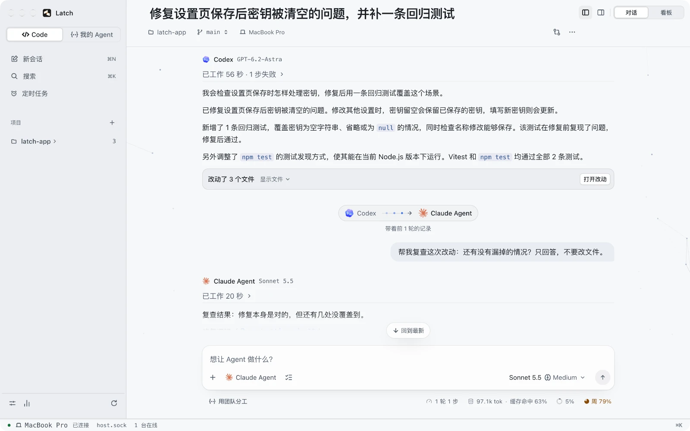
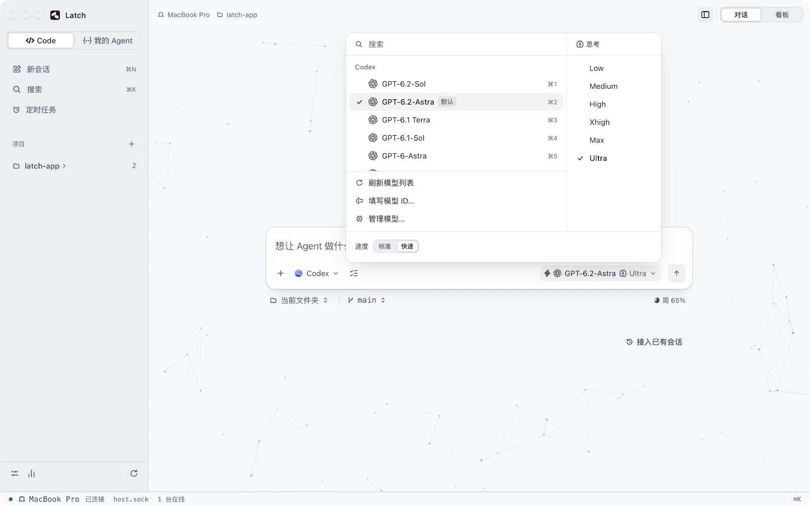
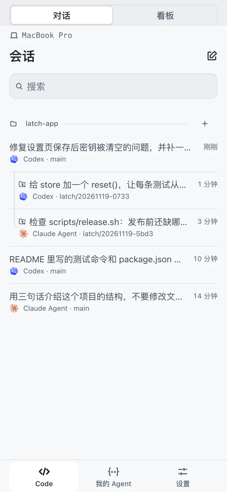
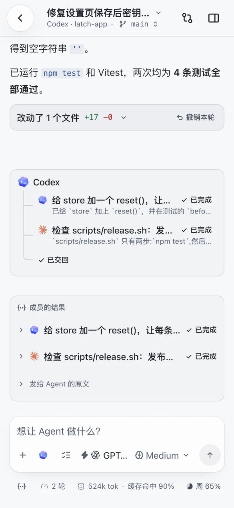

<p align="center"></p>

<h1 align="center">Latch</h1>

<p align="center">用你电脑上已经装好的 Codex、Claude Code 等 Agent，在桌面、浏览器和手机上接着干。</p>

<p align="center">
  <a href="README.en.md">English</a> ·
  <a href="docs/USAGE.md">使用说明</a> ·
  <a href="docs/HARNESSES.md">Harness</a> ·
  <a href="docs/ARCHITECTURE.md">架构</a>
</p>

<p align="center">
  
</p>

Latch 在你的 Mac 上运行一个 Host，会话、执行权限、密钥、设备登记与审计都在这里。每个会话由 Harness（你本机已登录的 Agent，或 Latch 内置的执行循环）、模型和项目组成。桌面端、浏览器和手机连同一个 Host：看同一份进度，批准同一个操作，取消同一个任务。关掉页面不会取消任务，断线后从 Host 的状态恢复。

<p align="center">
  
  <br><sub>真实录屏：本机的 Codex 在示例项目里修复问题并补测试，等待部分加速约 7 倍。</sub>
</p>

## 核心能力

<table>
<tr>
<td width="44%" valign="middle">

### 同一对话，换 Harness 继续

在对话里换到另一个 Harness，它带着前面的记录接着做，也可以只带一份交接说明。换回用过的 Harness 时，支持分叉的 Harness 会接上自己原来的会话，不必从头读一遍。

</td>
<td></td>
</tr>
<tr>
<td valign="middle">

### 团队分工

把一件事分给最多 8 个成员，每个成员各选一个 Harness 同时做；项目是 Git 仓库时，每个成员在自己的工作树里。全部结束后，结果作为一条消息交回这个会话，由它核对和汇总。

</td>
<td></td>
</tr>
<tr>
<td valign="middle">

### 模型、思考、速度与权限，一个入口

输入框里直接选 Harness、模型、思考深度、速度与权限档位，取值来自 Harness 自己的报告。额度和本次会话的用量就在输入框下方。

</td>
<td></td>
</tr>
</table>

### 任一 Harness，任一模型

部分 Harness 可以经 Latch 的模型网关使用你在 Latch 里添加的模型服务（Chat Completions、Responses 或 Anthropic Messages），模型来源与 Harness 分开选。哪些 Harness、哪些协议见 [HARNESSES](docs/HARNESSES.md#经-latch-使用模型服务)。

### 在手机上接着干

手机经 HTTPS 打开同一个 Host：看进度、批准操作、追加消息、停止任务。不在同一个网络时，经你自己的中继接入。

**还有：** 每轮的改动记录与撤销 · 暂存、提交、推送与 PR · 在新的 Git 工作树里开始会话 · 终端与预览浏览器（这台 Mac 的桌面端） · iOS 模拟器的实时画面 · Office、PDF、表格与代码的预览 · 带长期记忆和定时任务的「我的 Agent」 · 接入 Harness 原有的会话 · MCP 服务器 · 插件与自定义外观。

## 支持的 Harness

[Codex](https://github.com/openai/codex) · [Claude Agent](https://github.com/agentclientprotocol/claude-agent-acp)（运行 Claude Code） · [pi](https://github.com/earendil-works/pi) · [OpenCode](https://github.com/anomalyco/opencode) · [DeepSeek Harness](https://github.com/deepseek-ai/deepseek-harness) · [Qwen Code](https://github.com/QwenLM/qwen-code) · [goose](https://github.com/block/goose) · [Cursor](https://cursor.com/docs/cli/acp) · [Antigravity](https://antigravity.google/docs/ide/extensions/acp/) · [Grok Build](https://docs.x.ai/build) · Latch 内置 · 你自己填写的 ACP 命令

安装命令、最低版本、许可证与登录方式见[使用说明](docs/USAGE.md#先装好一个-harness)。

## 为什么是 Latch

- **用你已有的 Agent 和订阅。** Latch 不下载、不修改 Agent，也不改它们的配置；Harness 用它自己的登录。
- **Host 是唯一权威。** 任务在 Host 上运行；关掉页面、换设备、断线重连都不会让进度回退或重复。取消要等执行端真正停下才确认。
- **信任只在连接时建立一次。** 新设备、扩大权限、自填模型地址等要在这台 Mac 上用 Touch ID 确认；之后的日常操作不再弹窗，只留审计记录；授予与执行权限的操作先写入哈希链审计。
- **密钥留在这台 Mac。** 模型密钥只在 Mac 上填写，不返回任何设备；经 Latch 使用模型服务的 Harness 拿到的是随进程失效的凭据。
- **没有账号，没有云端。** 设备、权限与会话都由 Mac 上的 Host 决定。其他网络经你自己的中继接入，中继读不到正文。
- **边界写在明处。** Agent 与插件以 Host 的权限运行，Latch 不提供操作系统沙箱；审批是看管程度，不是隔离。见[安全边界](docs/USAGE.md#安全边界)。

## 安装与启动

需要 macOS、Node.js 24.22.1、pnpm 11.28.6、Xcode 命令行工具与 Go 1.26.10（构建用），以及至少一个已安装并登录的 Harness。

```sh
corepack pnpm install
corepack pnpm build
corepack pnpm desktop
```

第一次打开，桌面端会列出在这台 Mac 上找到的 Harness。不配置模型先体验流程：`corepack pnpm desktop -- --demo`（演示模型，界面会标注）。正式签名的安装包尚未提供；`pnpm package:desktop` 可生成供本机使用的 ad-hoc 签名应用，用你自己的 Developer ID 签名与公证见[使用说明](docs/USAGE.md#正式签名与公证)。完整步骤、启动参数与 `pnpm latch` 命令见[使用说明](docs/USAGE.md)。

## 手机接入

<p align="center">
  
  &nbsp;&nbsp;
  
  <br><sub>手机浏览器中的 Latch 页面</sub>
</p>

- **手机浏览器**：用你自己的 HTTPS 证书（例如 `tailscale cert`）启动 Host，运行 `pnpm latch device invite` 扫码，再在 Mac 上确认一次。见[手机接入](docs/USAGE.md#手机接入https)。
- **iPhone 与 iPad App**：源码在 [`native/ios`](native/ios)，在桌面端「设置 → 设备 → 连接手机」扫码配对；手机要和 Mac 在同一个 Wi‑Fi，或用数据线连着 Mac 并打开个人热点。尚未上架，真机验收还没有做完。
- **不在同一个网络**：经你自己的中继（Linux 服务器或你自己的 Cloudflare 账户），见 [RELAY](docs/RELAY.md)。

## 文档

| 主题 | 文档 |
| --- | --- |
| 安装、启动参数、手机接入、`pnpm latch`、数据目录与限制 | [USAGE](docs/USAGE.md) |
| 接入本机 Agent、权限模式、额度、经 Latch 使用模型服务 | [HARNESSES](docs/HARNESSES.md) |
| MCP 服务器与 `latch-mcp` | [MCP](docs/MCP.md) |
| 自建中继 | [RELAY](docs/RELAY.md) |
| 插件、插件页面、连接插件 | [PLUGIN-DEVELOPMENT](docs/PLUGIN-DEVELOPMENT.md)、[APP-PAGES](docs/APP-PAGES.md)、[TRANSPORT-PLUGINS](docs/TRANSPORT-PLUGINS.md) |
| 自定义外观与快捷键 | [CUSTOMIZATION](docs/CUSTOMIZATION.md) |
| 架构、安全模型、流式同步 | [ARCHITECTURE](docs/ARCHITECTURE.md)、[STREAMING](docs/STREAMING.md) |
| 界面设计、测试 | [DESIGN](docs/DESIGN.md)、[TESTING](docs/TESTING.md) |

参与开发前先读 [AGENTS.md](AGENTS.md)：命令、不变量、本机运行安全与完成标准都在那里。

## 许可证

源代码以 [MIT License](LICENSE) 授权。"Latch" 名称与图标不在该许可范围内。随产品分发的第三方组件与品牌图标保留各自的许可证，说明见 [apps/web/public/licenses/README.txt](apps/web/public/licenses/README.txt)。
