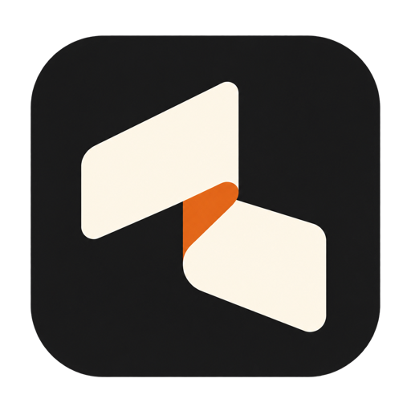

<h1 align="center"> Latch</h1>

<p align="center"><strong>One workbench for the agents on your computer, open on every device you own.</strong></p>

<p align="center">
  English · <a href="README.zh-CN.md" lang="zh-CN">简体中文</a> · <a href="#quick-start">Quick start</a> · <a href="#documentation">Docs</a> · <a href="#contributing">Contributing</a>
</p>

<a href=".github/readme/hero.webp">
  <picture>
    <source media="(max-width: 600px) and (prefers-color-scheme: dark)" srcset=".github/readme/hero-mobile-dark.webp">
    <source media="(max-width: 600px)" srcset=".github/readme/hero-mobile.webp">
    <source media="(prefers-color-scheme: dark)" srcset=".github/readme/hero-dark.webp">
    
  </picture>
</a>

<p align="center">
  <picture>
    <source media="(prefers-color-scheme: dark)" srcset=".github/readme/agents-dark.png">
    
  </picture>
</p>

<p align="center"><sub>Works with Codex, Claude Code, OpenCode, pi, DeepSeek Harness, Qwen Code, goose, Cursor, Antigravity, Grok Build, and any <a href="docs/USAGE.md#先装好一个-harness">ACP agent</a>.</sub></p>

> [!NOTE]
> I maintain Latch on my own and may not get to GitHub Issues every day. If something is urgent or blocking you, email me at [nirvanaxiaojie@gmail.com](mailto:nirvanaxiaojie@gmail.com).

---

Latch runs coding agents like Codex and Claude Code on your Mac. Start a team in one conversation, give each agent a different part of the job, then check in from your phone. Closing the window leaves the agents running on your Mac.

In the sample session above, Codex has reviewed draft storage and the built-in agent has checked reconnection. Claude Agent wants to run the recovery tests, and the phone is where that command gets approved.

## Why Latch?

- **Run an agent team.** Choose **Split work with a team** in a session and pick a Harness for each task. Members can work in separate Git worktrees. Their replies come back to the original conversation, where you can send a member another task.
- **Hand work from one agent to another.** Ask Claude Code to investigate a failing test, then give Codex the conversation or a summary of the findings so it can implement the fix. Latch uses the CLIs you install and keeps its settings separate from theirs.
- **Review the code where you discussed it.** See what changed in each turn, leave a note on a line, or undo that turn’s edits. When the patch is ready, stage it, commit, push, and open a pull request from Latch.
- **Choose what each device can do.** Pair a phone for viewing, or give it permission to run tasks and approve changes. The Host on your Mac keeps the session history, checks device permissions, and stores your model service keys. Agents and plugins run with your Mac user’s permissions. [Security boundary](docs/USAGE.md#安全边界)

## Quick start

Latch runs from source on macOS for now. A signed installer is not yet available. You’ll need Node.js 24.22.1, pnpm 11.28.6, Go 1.26.10, and the Xcode Command Line Tools.

**1. Install an agent and sign in.** Any supported agent works. With Codex, for example:

```sh
npm i -g @openai/codex
codex login
```

[Agent setup](docs/USAGE.md#先装好一个-harness) lists the commands for the others.

**2. Build and open Latch.** From the root of this repository:

```sh
corepack pnpm install
corepack pnpm build
corepack pnpm desktop
```

**3. Start a session.** Open **New session**, choose your agent, and add a project folder. Try asking “Where does this project handle errors? Show me one example.”

To look around before you set up an agent, skip step 1 and launch the demo. It uses a simulated model, and its file tools still operate on the folder you select.

```sh
corepack pnpm desktop -- --demo
```

## Connect a phone

- **Mobile browser.** Start the Host with your own HTTPS certificate. On the Mac, run `pnpm latch device invite`, scan the QR code with your phone, and confirm the connection on the Mac. [HTTPS setup](docs/USAGE.md#手机接入https)
- **iPhone or iPad app.** Build the app from source and put both devices on the same local network. In Latch on the Mac, open **Settings → Devices → Show QR code**. Scan it in the app and confirm on the Mac. After pairing, the app can reach your Mac from another network through a relay you host. The app has yet to ship on the App Store or complete testing on physical devices. [iOS source](native/ios) · [Relay setup](docs/RELAY.md)

## Documentation

The detailed guides are in Chinese.

- [Usage guide](docs/USAGE.md) · [Agent compatibility, models, and permissions](docs/HARNESSES.md)
- [Connect a custom ACP agent](docs/USAGE.md#先装好一个-harness) · [Use your own model service](docs/USAGE.md#模型服务)
- [MCP servers](docs/MCP.md) · [Plugin development](docs/PLUGIN-DEVELOPMENT.md) · [Plugin pages](docs/APP-PAGES.md) · [Transport plugins](docs/TRANSPORT-PLUGINS.md)
- [My Agents, memory, and scheduled tasks](docs/ARCHITECTURE.md#我的-agent-与定时) · [Appearance](docs/CUSTOMIZATION.md)
- [Architecture](docs/ARCHITECTURE.md) · [Streaming and reconnection](docs/STREAMING.md) · [Design](docs/DESIGN.md) · [Testing](docs/TESTING.md)

## Contributing

Latch is maintained by one person, so small, focused changes are the easiest to review.

- Read the [contributor guide](AGENTS.md) first. It has the code map, the commands, and the rules a change must keep.
- Run `corepack pnpm check:quick` before you open a pull request. [Testing](docs/TESTING.md) explains which tests a change needs.
- [Architecture](docs/ARCHITECTURE.md) explains how the Host, the clients, and the agents fit together.

## License

The source code is MIT licensed. The Latch name and icon are excluded from that license. Bundled third-party components and brand icons retain their respective licenses. [MIT License](LICENSE) · [Third-party notices](apps/web/public/licenses/README.txt)
