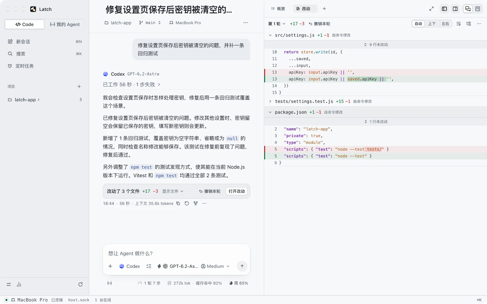
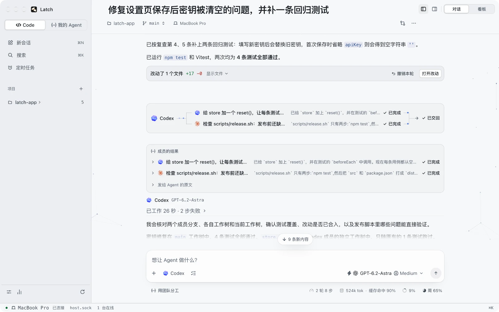
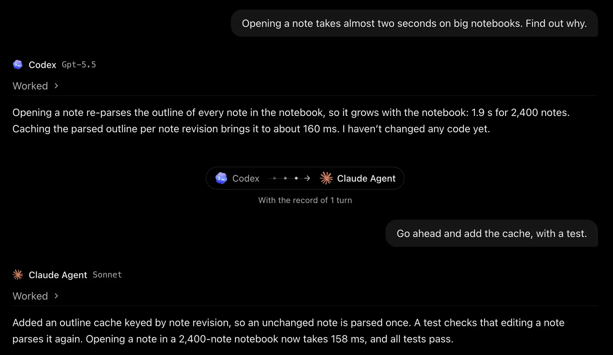
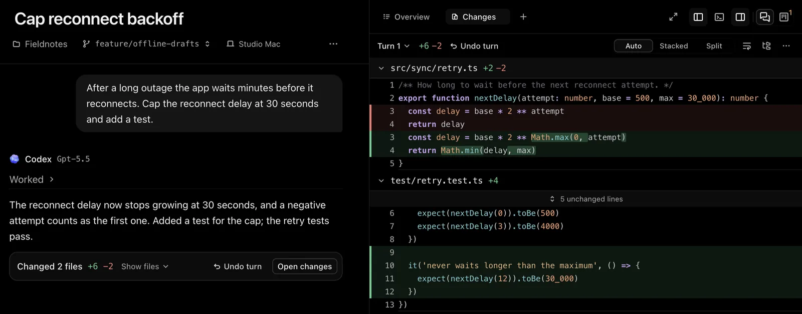

<h1 align="center"> Latch</h1>

<p align="center"><strong>One workbench for the agents on your computer, open on every device you own.</strong></p>

<p align="center">Run Codex, Claude Code and other coding agents on your Mac, alone or as a team.<br>Review and ship their work there, and keep up from your phone.</p>

<p align="center">
  English · <a href="README.zh-CN.md" lang="zh-CN">简体中文</a> · <a href="#quick-start">Quick start</a> · <a href="#documentation">Docs</a> · <a href="#contributing">Contributing</a>
</p>

<a href=".github/readme/hero.webp">
  <picture>
    <source media="(max-width: 600px)" srcset=".github/readme/hero-mobile.webp">
    
  </picture>
</a>

<p align="center">
  <picture>
    <source media="(prefers-color-scheme: dark)" srcset=".github/readme/agents-dark.png">
    
  </picture>
</p>

<p align="center"><sub>Works with Codex, Claude Code, OpenCode, pi, DeepSeek Harness, Qwen Code, goose, Cursor, Antigravity, Grok Build, and any <a href="docs/USAGE.md#先装好一个-harness">ACP agent</a>.</sub></p>

Latch keeps a Host running on your Mac. The Host starts the agent CLIs you already use, with their own sign-in, and holds every session, so the Mac app, a browser and your phone show the same conversation. Closing the window leaves the agents working.

In the picture, Codex has reviewed draft storage and the built-in agent has checked reconnection. Claude Agent wants to run the recovery tests, and the phone is where that command gets approved.

## What you can do

<table>
  <tr>
    <td width="42%">
      <h3>Split the work across agents</h3>
      <p>Choose <strong>Split work with a team</strong> in a conversation and give each task its own agent and model. Members work at the same time (in a Git project, each in its own worktree), and their results come back to the conversation that started them. From there you can send any member another round.</p>
      <p><a href="docs/ARCHITECTURE.md#团队与交接">Docs</a></p>
    </td>
    <td width="58%"></td>
  </tr>
  <tr>
    <td width="42%">
      <h3>Hand the work to another agent</h3>
      <p>Ask Codex why notes open slowly, then switch the conversation to Claude Code to write the fix. The next agent gets the earlier turns, or a summary the first one writes for it.</p>
      <p><a href="docs/ARCHITECTURE.md#团队与交接">Docs</a></p>
    </td>
    <td width="58%"></td>
  </tr>
  <tr>
    <td width="42%">
      <h3>Review each turn, then ship it</h3>
      <p>See what each turn changed, leave a note on a line for the agent, or undo the turn. When the patch is ready, stage, commit and push from the Delivery panel, and open a GitHub pull request with your <code>gh</code> sign-in.</p>
      <p><a href="docs/ARCHITECTURE.md#改动与文件编辑">Docs</a></p>
    </td>
    <td width="58%"></td>
  </tr>
</table>

### Beside the conversation

- **Board.** Every session by state (Needs you, In progress, Ready to deliver, Ended), filtered by project or agent.
- **Panels.** Files, Terminal, Browser, and Devices for the iOS Simulator.
- **Control this Mac.** Agents can operate your Mac’s apps through [Cua Driver](docs/MCP.md#操控这台-mac), which you install yourself.
- **Your models.** Use each CLI’s own sign-in, or add a model service that speaks Chat Completions, Responses or Anthropic Messages, including a local one such as Ollama. Limits and Usage show plan limits where the agent reports them, and token use.
- **Earlier sessions.** [Import](docs/HARNESSES.md#接入已有会话) sessions you ran in Codex, Claude Code, OpenCode, Grok Build or pi outside Latch.
- **My Agents.** Personal agents with their own memory and scheduled tasks.
- **Extensions.** [MCP servers](docs/MCP.md), [plugins](docs/PLUGIN-DEVELOPMENT.md) and [plugin pages](docs/APP-PAGES.md).

## Quick start

> [!IMPORTANT]
> Latch runs from source on macOS for now. There is no signed installer yet, and the iPhone and iPad app is not on the App Store. See [Status](#status).

You’ll need Node.js 24.22.1, pnpm 11.28.6 (through Corepack), Go 1.26.10 and the Xcode Command Line Tools.

**1. Install an agent and sign in.** Any supported agent works. With Codex, for example:

```sh
npm i -g @openai/codex
codex login
```

[Agent setup](docs/USAGE.md#先装好一个-harness) lists the commands for the others.

**2. Build and open Latch.** From the root of this repository:

```sh
corepack pnpm install
corepack pnpm build
corepack pnpm desktop
```

**3. Start a session.** Open **New session**, choose your agent, and add a project folder. Try asking “Where does this project handle errors? Show me one example.”

To look around before you set up an agent, skip step 1 and launch the demo. It uses a simulated model, and its file tools still operate on the folder you select.

```sh
corepack pnpm desktop -- --demo
```

## Connect a phone

- **Mobile browser.** Start the Host with your own HTTPS certificate. On the Mac, run `pnpm latch device invite`, scan the QR code with your phone, and confirm the connection on the Mac. [HTTPS setup](docs/USAGE.md#手机接入https)
- **iPhone or iPad app.** Build the app from source and put both devices on the same local network. In Latch on the Mac, open **Settings → Devices → Show QR code**. Scan it in the app and confirm on the Mac. After pairing, the app can reach your Mac from another network through a relay you host. [iOS source](native/ios) · [Relay setup](docs/RELAY.md)

## Security

- **You trust a device once, when it connects.** The first desktop app on a new Host connects without a prompt. After that, the Mac shows each new device’s name and you confirm with Touch ID or your login password. The device then works within the permissions you gave it (view, run, approve, manage this Mac) until you remove it, or until its credential expires 30 days after it connected.
- **Keys stay on the Mac.** Model keys are entered only on this Mac and are never sent to a device. Each device holds its own key, and the Host stores only public keys and credential hashes.
- **Permissions leave a record.** Anything that grants or uses a permission is first written to a hash-chained audit log, which you can read in **Settings → Data → Audit log** and check with `pnpm latch audit verify`.
- **Latch is not a sandbox.** Agents and plugins run as your Mac user. Approvals, path checks and the outbound policy are rules inside Latch, and worktrees separate only files.

More in [Security boundary](docs/USAGE.md#安全边界) and [Security model](docs/ARCHITECTURE.md#安全模型概览).

## Status

| | Status |
| --- | --- |
| Mac | Runs from source. A signed and notarized build hasn’t been produced yet, so there is no installer or automatic update. |
| iPhone and iPad | Builds from source and pairs with your Mac. Not on the App Store and not yet tested on physical devices. No push notifications. |
| Other devices | Any browser, over HTTPS with a certificate you provide. Latch doesn’t create certificates or offer plain-HTTP access. |
| Linux | The Host runs, but Linux has no on-device confirmation, so browsers and phones can’t connect. The desktop app connects with offline codes. |
| Windows | Not yet. The Host needs a per-user runtime directory for its socket, which isn’t implemented on Windows. |
| Android | No Android app yet; work so far covers iPhone and iPad. An Android phone can connect through its browser over HTTPS. |
| Relay | No official relay. [Run your own](docs/RELAY.md) on a Linux server or your Cloudflare account. |

Details in [Platform limits](docs/USAGE.md#平台限制与尚未实现).

## FAQ

**Does Latch change my agents’ settings?** No. It runs the CLI you installed with that CLI’s own sign-in, and keeps its settings in its own files. It doesn’t edit the CLI’s configuration or register global hooks.

**Is there an account or a cloud service?** No. The Host on your Mac decides devices, permissions and sessions. A relay only forwards end-to-end encrypted traffic; whoever runs it can still see IP addresses, times and sizes.

**What happens when I close the window?** The Host and the agents keep running. `pnpm stop` stops the Host, and refuses while a session is running or waiting for approval unless you add `--force`.

**Does my phone need to be on the same network?** Only for the first pairing of the app, or a cable to the Mac with Personal Hotspot on. After that it connects directly when it can, or through your relay.

## Documentation

The detailed guides are in Chinese.

- [Usage guide](docs/USAGE.md) · [Agent compatibility, models, and permissions](docs/HARNESSES.md)
- [Connect a custom ACP agent](docs/USAGE.md#先装好一个-harness) · [Use your own model service](docs/USAGE.md#模型服务)
- [MCP servers](docs/MCP.md) · [Plugin development](docs/PLUGIN-DEVELOPMENT.md) · [Plugin pages](docs/APP-PAGES.md) · [Transport plugins](docs/TRANSPORT-PLUGINS.md)
- [My Agents, memory, and scheduled tasks](docs/ARCHITECTURE.md#我的-agent-与定时) · [Appearance](docs/CUSTOMIZATION.md)
- [Architecture](docs/ARCHITECTURE.md) · [Streaming and reconnection](docs/STREAMING.md) · [Design](docs/DESIGN.md) · [Testing](docs/TESTING.md)

## Contributing

Latch is maintained by one person, so small, focused changes are the easiest to review.

- Read the [contributing guide](CONTRIBUTING.md) first. It covers the setup, how to run Latch without touching your own data, the checks, and the pull request process.
- [AGENTS.md](AGENTS.md) has the code map, the commands, and the rules a change must keep. [Testing](docs/TESTING.md) explains which tests a change needs.
- [Architecture](docs/ARCHITECTURE.md) explains how the Host, the clients, and the agents fit together.

> [!NOTE]
> I may not get to GitHub Issues every day. If something is urgent or blocking you, email me at [nirvanaxiaojie@gmail.com](mailto:nirvanaxiaojie@gmail.com). Report security issues by email, not in a public issue.

## License

The source code is MIT licensed. The Latch name and icon are excluded from that license. Bundled third-party components and brand icons retain their respective licenses. [MIT License](LICENSE) · [Third-party notices](apps/web/public/licenses/README.txt)
