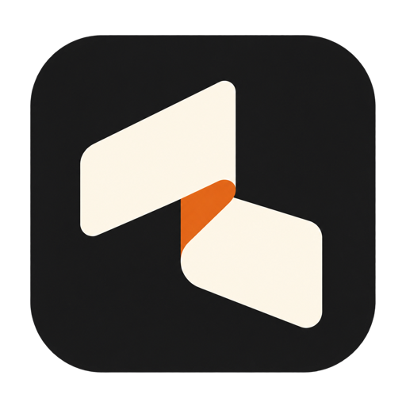
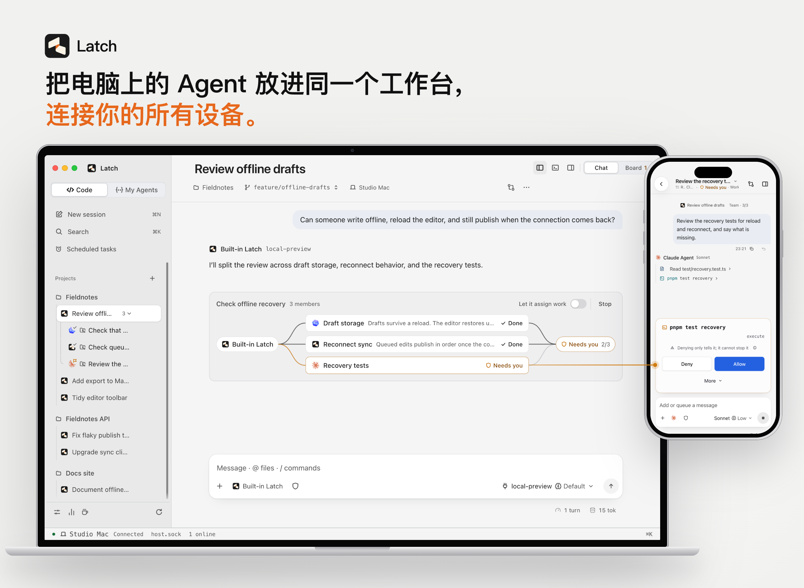

<h1 align="center"> Latch</h1>

<p align="center"><strong>把电脑上的 Agent 放进同一个工作台，连接你的所有设备。</strong></p>

<p align="center">
  <a href="README.md" lang="en">English</a> · 简体中文 · <a href="#快速开始">快速开始</a> · <a href="#文档">文档</a> · <a href="#参与贡献">参与贡献</a>
</p>

<a href=".github/readme/hero.zh-CN.webp">
  <picture>
    <source media="(max-width: 600px) and (prefers-color-scheme: dark)" srcset=".github/readme/hero-mobile-dark.zh-CN.webp">
    <source media="(max-width: 600px)" srcset=".github/readme/hero-mobile.zh-CN.webp">
    <source media="(prefers-color-scheme: dark)" srcset=".github/readme/hero-dark.zh-CN.webp">
    
  </picture>
</a>

<p align="center">
  <picture>
    <source media="(prefers-color-scheme: dark)" srcset=".github/readme/agents-dark.png">
    
  </picture>
</p>

<p align="center"><sub>支持 Codex、Claude Code、OpenCode、pi、DeepSeek Harness、Qwen Code、goose、Cursor、Antigravity、Grok Build，以及任何 <a href="docs/USAGE.md#先装好一个-harness">ACP Agent</a>。</sub></p>

> [!NOTE]
> 我是独立维护者，不一定每天都能及时处理 GitHub Issues。如果问题很紧急或阻塞了你，可以直接发邮件到 [nirvanaxiaojie@gmail.com](mailto:nirvanaxiaojie@gmail.com)。

---

用 Latch 调用 Mac 上的 Codex、Claude Code 等 Agent，可以在一段对话里给它们分工。关掉窗口，它们会在 Mac 上继续运行。你可以从手机打开同一段对话，看每个成员做到哪一步、交回了什么。

上图的示例审查里，Codex 查完了草稿存储，Latch 内置 Agent 查完了断线重连，Claude Agent 要运行恢复测试，这条命令正在手机上等你批准。

## 为什么用 Latch？

- **让一组 Agent 分工。** 在会话里点「用团队分工」，给每项任务选一个 Harness。成员可以在各自的 Git 工作树里并行工作。它们的回复会回到原会话，你还可以点名让某个成员再做一轮。
- **让另一个 Agent 接着做。** 可以先让 Claude Code 查一个测试为什么失败，再把对话记录或一段交接说明交给 Codex 修复。Latch 调用你安装的 CLI，单独保存自己的配置。
- **在对话里审改动。** 按轮查看 diff，在某一行留言，或撤销这一轮的修改。准备好后，直接在 Latch 里暂存、提交、推送，再开 PR。
- **自己决定每台设备能做什么。** 可以把手机设为只读，也可以允许它发起任务、批准改动。Mac 上的 Host 保存会话记录和模型服务密钥，并核对设备权限。Agent 与插件以你的 Mac 用户权限运行。[安全边界](docs/USAGE.md#安全边界)

## 快速开始

目前在 macOS 上从源码运行，签名安装包尚未提供。需要 Node.js 24.22.1、pnpm 11.28.6、Go 1.26.10 和 Xcode 命令行工具。

**1. 装好一个 Agent 并登录。** 任选一个支持的 Agent，以 Codex 为例：

```sh
npm i -g @openai/codex
codex login
```

其他 Agent 的命令见[各 Agent 的安装方式](docs/USAGE.md#先装好一个-harness)。

**2. 构建并打开 Latch。** 在本仓库根目录运行：

```sh
corepack pnpm install
corepack pnpm build
corepack pnpm desktop
```

**3. 开始一个会话。** 打开「新会话」，选择 Agent，添加项目文件夹。可以先问一句：「这个项目在哪里处理错误？举一个例子。」

想先看看界面，可以跳过第 1 步，直接启动演示模式。它使用模拟模型，文件工具仍会读写你选择的文件夹。

```sh
corepack pnpm desktop -- --demo
```

## 用手机接着做

- **手机浏览器。** 用自己的 HTTPS 证书启动 Host，在 Mac 上运行 `pnpm latch device invite`，用手机扫码，再在 Mac 上确认连接。[配置 HTTPS](docs/USAGE.md#手机接入https)
- **iPhone 或 iPad App。** 从源码构建 App，让两台设备连入同一局域网。在 Mac 的 Latch 里打开「设置 → 设备 → 显示二维码」，用 App 扫码，在 Mac 上确认。配对后也可以通过自建中继从其他网络接回这台 Mac。App 尚未上架，真机验收仍待完成。[iOS 源码](native/ios) · [中继配置](docs/RELAY.md)

## 文档

- [使用说明](docs/USAGE.md) · [Agent 接入、模型与权限](docs/HARNESSES.md)
- [接入自定义 ACP Agent](docs/USAGE.md#先装好一个-harness) · [使用自己的模型服务](docs/USAGE.md#模型服务)
- [MCP 服务器](docs/MCP.md) · [插件开发](docs/PLUGIN-DEVELOPMENT.md) · [插件页面](docs/APP-PAGES.md) · [传输插件](docs/TRANSPORT-PLUGINS.md)
- [我的 Agent、记忆与定时任务](docs/ARCHITECTURE.md#我的-agent-与定时) · [外观设置](docs/CUSTOMIZATION.md)
- [架构](docs/ARCHITECTURE.md) · [流式消息与重连](docs/STREAMING.md) · [界面设计](docs/DESIGN.md) · [测试](docs/TESTING.md)

## 参与贡献

Latch 由一个人维护，小而聚焦的改动最容易审阅。

- 先读[贡献手册](AGENTS.md)：代码地图、命令，以及改动必须守住的规则都在里面。
- 提交 PR 前运行 `corepack pnpm check:quick`。[测试](docs/TESTING.md)说明了每类改动要跑哪些用例。
- [架构](docs/ARCHITECTURE.md)说明 Host、各客户端和 Agent 怎样配合。

## 许可证

源代码采用 MIT 许可证。Latch 的名称与图标不在该许可范围内。随产品分发的第三方组件与品牌图标保留各自的许可证。[MIT 许可证](LICENSE) · [第三方许可说明](apps/web/public/licenses/README.txt)
