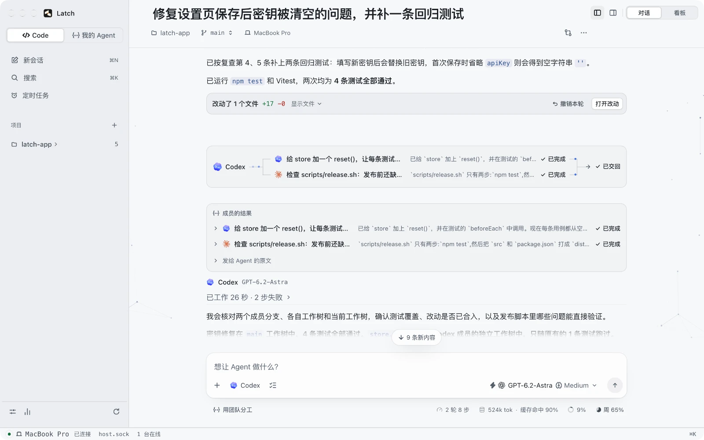
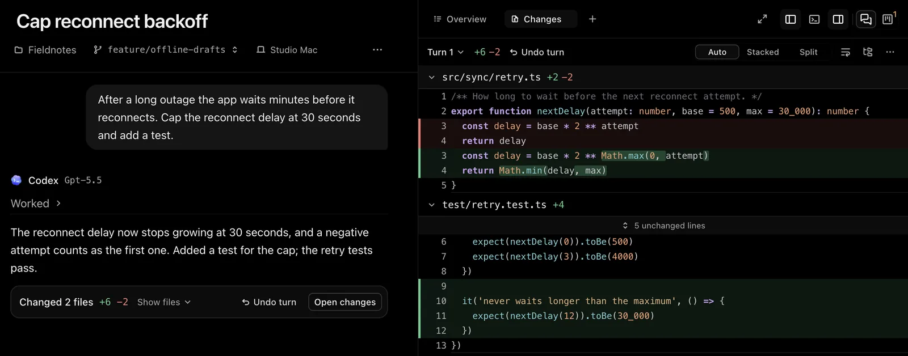

<h1 align="center"> Latch</h1>

<p align="center"><strong>把电脑上的 Agent 放进同一个工作台，连接你的所有设备。</strong></p>

<p align="center">在 Mac 上运行 Codex、Claude Code 等编程 Agent，单独用或组队分工。<br>在 Mac 上审阅、交付它们的改动，用手机随时跟进。</p>

<p align="center">
  <a href="README.md" lang="en">English</a> · 简体中文 · <a href="#快速开始">快速开始</a> · <a href="#文档">文档</a> · <a href="#参与贡献">参与贡献</a>
</p>

<a href=".github/readme/hero.webp">
  <picture>
    <source media="(max-width: 600px)" srcset=".github/readme/hero-mobile.webp">
    
  </picture>
</a>

<p align="center">
  <picture>
    <source media="(prefers-color-scheme: dark)" srcset=".github/readme/agents-dark.png">
    
  </picture>
</p>

<p align="center"><sub>支持 Codex、Claude Code、OpenCode、pi、DeepSeek Harness、Qwen Code、goose、Cursor、Antigravity、Grok Build，以及任何 <a href="docs/USAGE.md#先装好一个-harness">ACP Agent</a>。</sub></p>

Latch 在你的 Mac 上运行一个 Host。Host 用你已经装好、登录好的 Agent CLI 开始会话，并保存所有会话，所以 Mac 上的 Latch、浏览器和手机看到的是同一段对话。关掉窗口，Agent 会继续工作。

上图里，Codex 查完了草稿存储，Latch 内置 Agent 查完了断线重连，Claude Agent 要运行恢复测试，这条命令正在手机上等你批准。

## 能做什么

<table>
  <tr>
    <td width="42%">
      <h3>让几个 Agent 分工</h3>
      <p>在对话里点「用团队分工」，给每项任务选 Agent 和模型。成员同时工作（Git 项目里各自在自己的工作树中），结果回到发起它们的那段对话；你还可以在那里点名让某个成员再做一轮。</p>
      <p><a href="docs/ARCHITECTURE.md#团队与交接">文档</a></p>
    </td>
    <td width="58%"></td>
  </tr>
  <tr>
    <td width="42%">
      <h3>换一个 Agent 接着做</h3>
      <p>先让 Codex 查笔记为什么打开慢，再把对话换给 Claude Code 写修复。接手的 Agent 拿到之前的对话记录，或者前一个 Agent 为它写的一段交接说明。</p>
      <p><a href="docs/ARCHITECTURE.md#团队与交接">文档</a></p>
    </td>
    <td width="58%"></td>
  </tr>
  <tr>
    <td width="42%">
      <h3>按轮审阅，再交付</h3>
      <p>看每一轮改了什么，在某一行给 Agent 留言，或撤销这一轮。准备好后，在「交付」面板里暂存、提交、推送，再用你的 <code>gh</code> 登录开 GitHub PR。</p>
      <p><a href="docs/ARCHITECTURE.md#改动与文件编辑">文档</a></p>
    </td>
    <td width="58%"></td>
  </tr>
</table>

### 对话旁边

- **看板。** 所有会话按状态排开（等你处理、进行中、可交付、已结束），可按项目或 Agent 筛选。
- **面板。** 文件、终端、浏览器，以及操作 iOS 模拟器的设备面板。
- **操控这台 Mac。** Agent 可以经 [Cua Driver](docs/MCP.md#操控这台-mac) 操作 Mac 上的 App，Cua Driver 由你自己安装。
- **你的模型。** 用各 CLI 自己的登录，或添加 Chat Completions、Responses、Anthropic Messages 协议的模型服务，包括 Ollama 这样的本机服务。「额度与用量」显示 Agent 报告的套餐额度和 token 用量。
- **以前的会话。** 把在 Latch 之外用 Codex、Claude Code、OpenCode、Grok Build 或 pi 做过的会话[接入](docs/HARNESSES.md#接入已有会话)进来。
- **我的 Agent。** 有自己的记忆和定时任务的个人 Agent。
- **扩展。** [MCP 服务器](docs/MCP.md)、[插件](docs/PLUGIN-DEVELOPMENT.md)与[插件页面](docs/APP-PAGES.md)。

## 快速开始

> [!IMPORTANT]
> 目前在 macOS 上从源码运行。签名安装包尚未提供，iPhone 与 iPad App 也还没有上架。见[现状](#现状)。

需要 Node.js 24.22.1、pnpm（已装较新版本即可，在仓库里会自动切换到固定的 11.28.6）、Go 1.26.10 和 Xcode 命令行工具。

**1. 装好一个 Agent 并登录。** 任选一个支持的 Agent，以 Codex 为例：

```sh
npm i -g @openai/codex
codex login
```

其他 Agent 的命令见[各 Agent 的安装方式](docs/USAGE.md#先装好一个-harness)。

**2. 构建并打开 Latch。** 在本仓库根目录运行：

```sh
pnpm install
pnpm build
pnpm desktop
```

**3. 开始一个会话。** 打开「新会话」，选择 Agent，添加项目文件夹。可以先问一句：「这个项目在哪里处理错误？举一个例子。」

想先看看界面，可以跳过第 1 步，直接启动演示模式。它使用模拟模型，文件工具仍会读写你选择的文件夹。

```sh
pnpm desktop -- --demo
```

## 用手机接着做

- **手机浏览器。** 用自己的 HTTPS 证书启动 Host，在 Mac 上运行 `pnpm latch device invite`，用手机扫码，再在 Mac 上确认连接。[配置 HTTPS](docs/USAGE.md#手机接入https)
- **iPhone 或 iPad App。** 从源码构建 App，让两台设备连入同一局域网。在 Mac 的 Latch 里打开「设置 → 设备 → 显示二维码」，用 App 扫码，在 Mac 上确认。配对后也可以通过自建中继从其他网络接回这台 Mac。[iOS 源码](native/ios) · [中继配置](docs/RELAY.md)

## 安全

- **信任在连接时建立一次。** 新 Host 上第一个桌面端连接时不需要确认；之后每台新设备连接，Mac 上都显示它的名称，由你用 Touch ID 或登录密码确认。设备随后按你给的权限工作（查看、运行、批准、管理这台 Mac），直到你移除它，或凭据在连接 30 天后失效。
- **密钥留在 Mac 上。** 模型密钥只在这台 Mac 上填写，不发给任何设备。每台设备持有自己的密钥，Host 只保存公钥和凭据哈希。
- **权限的使用都有记录。** 授予或使用权限的操作先写进哈希链审计记录，可以在「设置 → 数据 → 安全记录」查看，用 `pnpm latch audit verify` 校验。
- **Latch 不是沙箱。** Agent 与插件以你的 Mac 用户权限运行。审批、路径检查与出站策略是 Latch 内部的规则，工作树也只分开文件。

详见[安全边界](docs/USAGE.md#安全边界)与[安全模型](docs/ARCHITECTURE.md#安全模型概览)。

## 现状

| | 现状 |
| --- | --- |
| Mac | 从源码运行。签名并公证的版本还没有实际构建过，所以没有安装包和自动更新。 |
| iPhone 与 iPad | 从源码构建，与 Mac 配对。尚未上架，还没有在真机上验收；没有推送通知。 |
| 其他设备 | 任何浏览器，经你自己提供证书的 HTTPS。Latch 不生成证书，也没有明文 HTTP 接入。 |
| Linux | Host 可以运行，但 Linux 上没有本机确认，浏览器和手机无法连接；桌面端用离线连接码连接。 |
| Windows | 尚未实现：Host 需要放 `host.sock` 的每用户运行目录，Windows 上还没有实现。 |
| Android | 还没有 Android App，目前先做 iPhone 与 iPad；Android 手机可以经浏览器用 HTTPS 连接。 |
| 中继 | 没有官方中继，用 Linux 服务器或你自己的 Cloudflare 账户[自建](docs/RELAY.md)。 |

详见[平台限制与尚未实现](docs/USAGE.md#平台限制与尚未实现)。

## 常见问题

**Latch 会改我的 Agent 配置吗？** 不会。它用你安装的 CLI 和它自己的登录，配置单独保存，不改 CLI 的配置，也不注册全局 hooks。

**需要账号或云服务吗？** 不需要。设备、权限和会话都由 Mac 上的 Host 决定。中继只转发端到端加密的连接，运营方仍能看到 IP、时间和大小。

**关掉窗口会怎样？** Host 和 Agent 继续运行。`pnpm stop` 停止 Host；有会话正在运行或等待审批时它会拒绝，加 `--force` 才继续。

**手机要和 Mac 在同一网络吗？** 只有 App 第一次配对时需要，或者用数据线连接 Mac 并打开个人热点。之后能直连就直连，否则经你的中继。

## 文档

- [使用说明](docs/USAGE.md) · [Agent 接入、模型与权限](docs/HARNESSES.md)
- [接入自定义 ACP Agent](docs/USAGE.md#先装好一个-harness) · [使用自己的模型服务](docs/USAGE.md#模型服务)
- [MCP 服务器](docs/MCP.md) · [插件开发](docs/PLUGIN-DEVELOPMENT.md) · [插件页面](docs/APP-PAGES.md) · [传输插件](docs/TRANSPORT-PLUGINS.md)
- [我的 Agent、记忆与定时任务](docs/ARCHITECTURE.md#我的-agent-与定时) · [外观设置](docs/CUSTOMIZATION.md)
- [架构](docs/ARCHITECTURE.md) · [流式消息与重连](docs/STREAMING.md) · [界面设计](docs/DESIGN.md) · [测试](docs/TESTING.md)

## 参与贡献

Latch 由一个人维护，小而聚焦的改动最容易审阅。

- 先读[贡献指南](CONTRIBUTING.zh-CN.md)：环境准备、怎样不碰自己的数据运行 Latch、要跑的检查与 PR 流程都在里面。
- [AGENTS.md](AGENTS.md) 有代码地图、命令，以及改动必须守住的规则。[测试](docs/TESTING.md)说明了每类改动要跑哪些用例。
- [架构](docs/ARCHITECTURE.md)说明 Host、各客户端和 Agent 怎样配合。

> [!NOTE]
> 我是独立维护者，不一定每天都能处理 GitHub Issues。如果问题很紧急或阻塞了你，可以直接发邮件到 [nirvanaxiaojie@gmail.com](mailto:nirvanaxiaojie@gmail.com)。安全问题请发邮件，不要开公开 Issue。

## 许可证

源代码采用 MIT 许可证。Latch 的名称与图标不在该许可范围内。随产品分发的第三方组件与品牌图标保留各自的许可证。[MIT 许可证](LICENSE) · [第三方许可说明](apps/web/public/licenses/README.txt)
